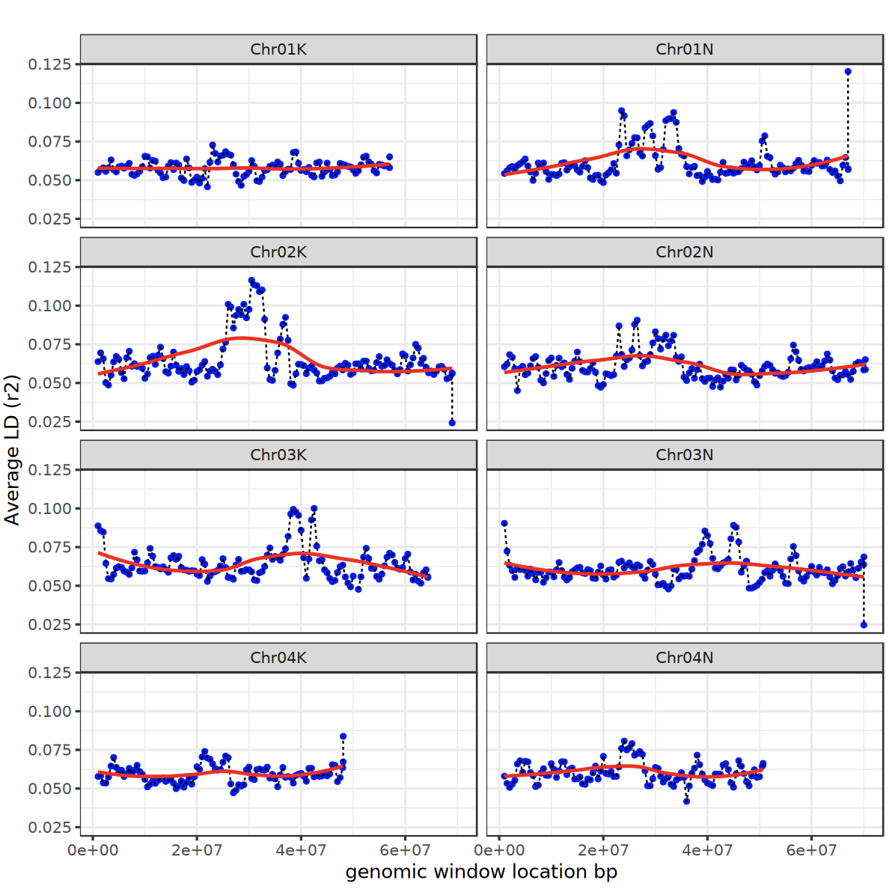

## Table of contents
* [General info](#general-info)
* [Authors of the analysis pipeline](#Authors-of-the-analysis-pipeline)
* [Project description](#AProject-description)

## General info
This repository contains scripts for assigning genes to SNPs.
SNP lists are the output of running GAPIT GWAS pipeline on phenotypes 

## Authors of the analysis pipeline
* Chanaka Roshan Abeyratne (CRA)
* Hari Chhetri (HBC)

## Project description

